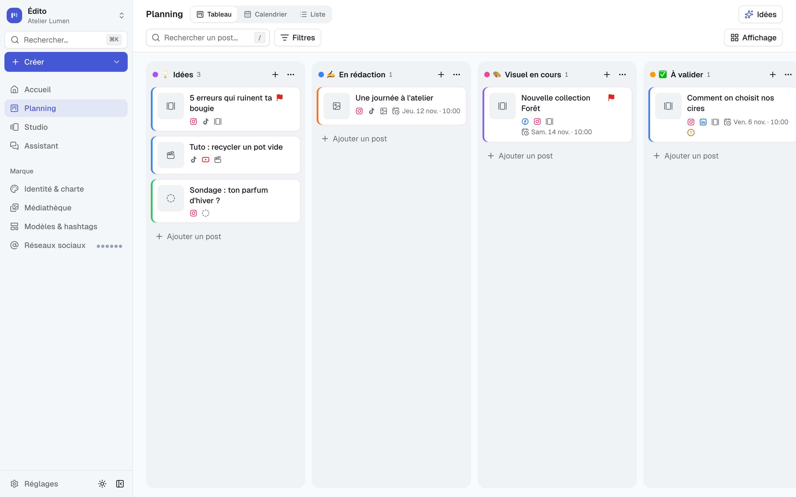
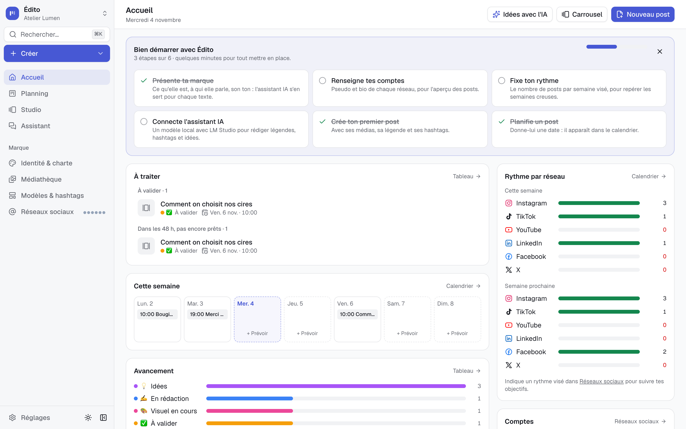
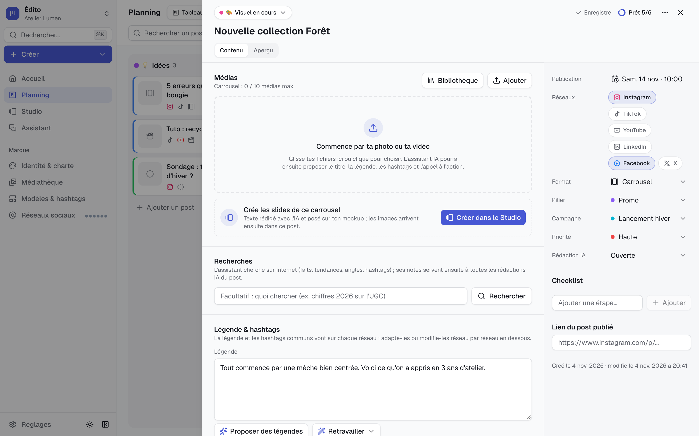
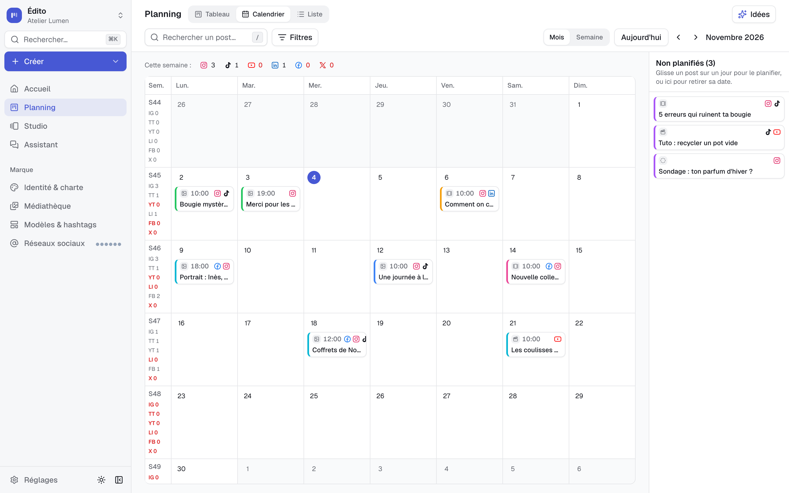
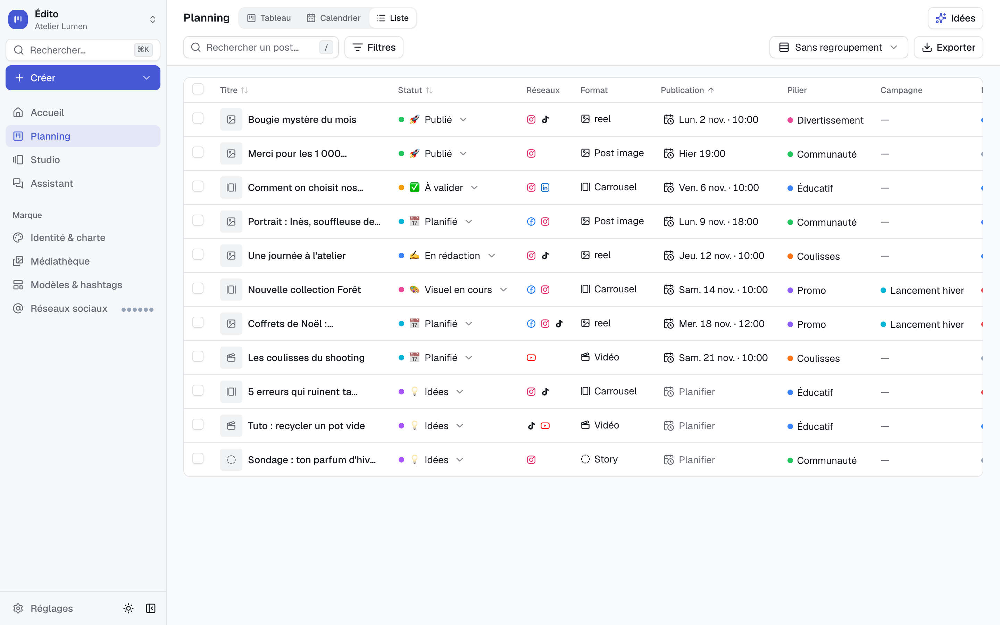
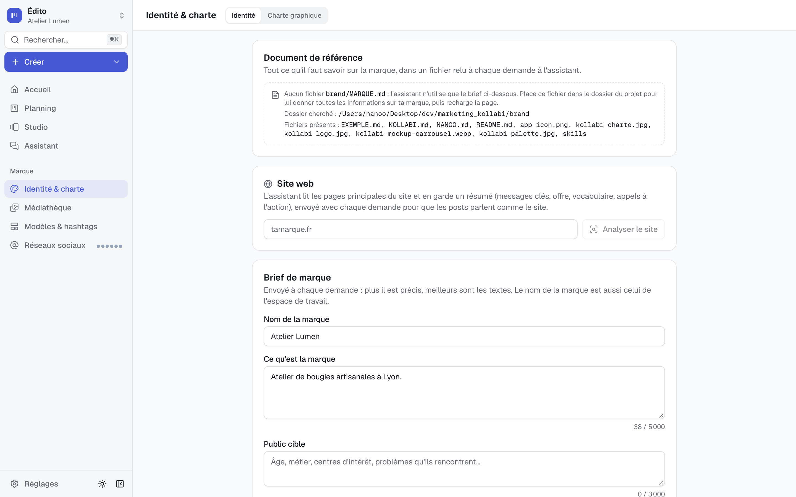
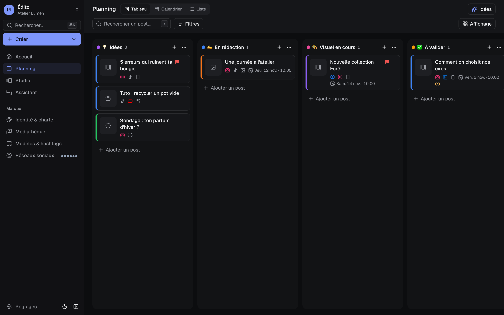
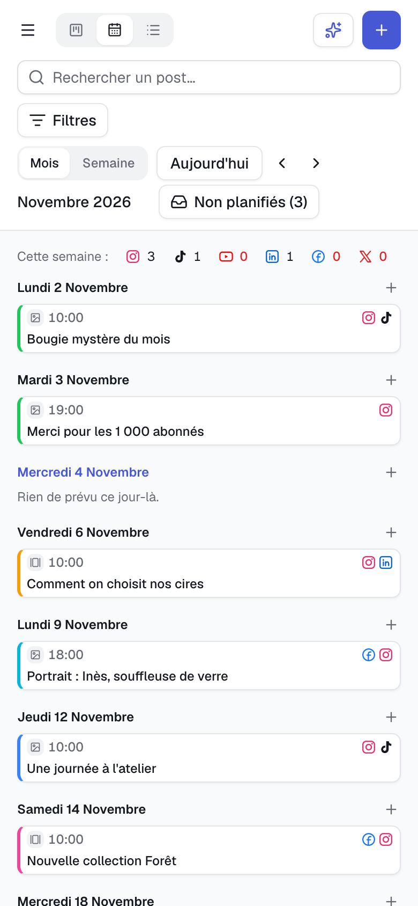

# Édito

**Le planning éditorial de tes réseaux sociaux, en local, avec un assistant IA qui tourne sur ta machine.**

Instagram, TikTok, YouTube, LinkedIn, Facebook et X : un kanban pour faire avancer chaque post de l'idée à la publication, un calendrier, un studio de carrousels et un assistant IA (LM Studio en local, ou OpenRouter). Tes données restent sur ton ordinateur : une base SQLite, pas de compte, pas de cloud.



## Aperçu

| Accueil | Fiche d'un post |
| --- | --- |
|  |  |
| **Calendrier** | **Liste** |
|  |  |
| **Marque** | **Thème sombre** |
|  |  |

<p align="center"></p>

## Fonctionnalités

- **Accueil** : posts à traiter (en retard, à valider, prévus sous 48 h mais pas prêts), semaine en cours, rythme par réseau, avancement, guide « Bien démarrer ».
- **Planning** en trois vues avec les mêmes filtres (réseau, format, pilier, campagne, priorité, état) :
  - **Tableau** : glisser-déposer (souris, tactile, clavier), colonnes avec un rôle (idée → publié) qui demandent la date ou le lien au bon moment, sélection multiple, ajout express.
  - **Calendrier** : mois / semaine, glisser un post sur un jour, objectifs par semaine, agenda en mobile.
  - **Liste** : statut et date modifiables dans la ligne, regroupement, export CSV.
- **Fiche d'un post** (enregistrement automatique) : médias, légende commune et par réseau avec compteurs, hashtags, checklist, aperçu façon Instagram / TikTok, vérificateur de légende.
- **Assistant IA** : rédige un post à partir de tes photos et vidéos, propose et retravaille les légendes, adapte à chaque réseau, cherche sur le web, discute dans l'onglet Assistant et ajoute ses idées au tableau.
- **Studio** : carrousels rédigés avec l'IA, aux couleurs et polices de ta charte, exportés en images vers le post.
- **Marque** : brief, document de référence, charte graphique, médiathèque, modèles, groupes de hashtags, fiche de chaque réseau (bio, objectifs, audit du profil).
- **Plusieurs marques** : un espace de travail = une base séparée.
- **Partout** : palette `⌘K`, raccourcis (`N`, `/`, `1`-`3`, `?`), thème clair / sombre, version mobile.

## Installation

Prérequis : [Node.js](https://nodejs.org) 20.9 ou plus récent. Google Chrome est utilisé (sans fenêtre) pour les recherches web et captures de l'assistant.

```bash
git clone <url-du-dépôt> edito
cd edito
npm install
npm run dev
```

Ouvre http://localhost:3000. Au premier lancement, la base est créée dans `data/` avec un espace « Ma marque », les colonnes, les piliers et des modèles de départ.

### Configurer ta marque

1. **Marque › Identité** : nom, description, public, ton. Puis la charte (couleurs, polices).
2. **Document de référence** (optionnel, très utile) : copie `brand/EXEMPLE.md` en `brand/MARQUE.md` et décris ton offre. L'assistant le relit à chaque demande et n'invente aucun fait qui n'y figure pas.
3. **Réseaux sociaux** : pseudo, bio, rythme visé ; « Non utilisé » masque un réseau partout.

### Assistant IA

- **En local avec [LM Studio](https://lmstudio.ai)** : charge un modèle (ex. `ministral-3-14b-reasoning`, contexte ≥ 8 000 tokens ; un modèle « vision » pour l'analyse des images), onglet **Developer → Start Server**, puis dans Édito **Réglages › Assistant IA → Tester**.
- **En ligne avec [OpenRouter](https://openrouter.ai)** : colle ta clé dans le même écran (elle reste côté serveur, jamais envoyée au navigateur) et choisis un modèle.

### Plusieurs marques (optionnel)

Copie `workspaces.example.json` en `workspaces.json` et liste tes espaces (nom, base, document de référence, piliers, brief, charte, guides, captures de ton app avec `appShots`). Redémarre l'app : un sélecteur apparaît en haut de la barre latérale.

### App de bureau (macOS, optionnel)

```bash
bash desktop/make-app.sh
```

Crée `/Applications/Édito.app`, qui compile et lance l'app dans une fenêtre Chrome dédiée. Icône : `brand/app-icon.png` si présente.

## Tes données

Tout ce qui t'appartient est ignoré par git :

| Emplacement | Contenu |
| --- | --- |
| `data/` | bases SQLite (une par espace), médias, espace ouvert. Change de dossier avec `EDITO_DATA_DIR`. |
| `brand/` | document de référence, icône (sauf `README.md`, `EXEMPLE.md` et `skills/`) |
| `workspaces.json` | tes espaces de travail |

Pour sauvegarder, copie `data/` (Réglages › Données indique où il se trouve).

## Commandes

| Commande | Rôle |
| --- | --- |
| `npm run dev` | Serveur de développement |
| `npm run build` / `npm start` | Build et serveur de production |
| `npm run lint` / `npm run typecheck` / `npm test` | Vérifications |
| `npm run db:generate` | Migration après une modification de `src/db/schema.ts` |
| `npm run db:studio` | Explorateur de la base (Drizzle Studio) |
| `npm run skills:update` | Met à jour les guides par réseau (`brand/skills/`) depuis GitHub |

## Stack

Next.js 16 (App Router, server actions), React 19, Tailwind CSS 4, composants façon shadcn/ui sur Radix, SQLite avec Drizzle, dnd-kit, Playwright (Chrome) pour le web, Vitest.

```
src/
  app/          pages (home, board, calendar, list, studio, brand, settings) et routes API
  components/   interface (shell, planning, board, posts, studio, library, ai, ui…)
  db/           schéma Drizzle, connexion, données de départ
  lib/          logique pure et prompts IA, avec leurs tests
  server/       lectures, server actions, appels au modèle, accès web
drizzle/        migrations SQL (appliquées au démarrage)
brand/skills/   guides open source par réseau (licences dans leur README)
```

## Licence

[MIT](LICENSE) : utilise, modifie, revends ou redistribue Édito comme tu veux. Les guides de `brand/skills/` gardent leur propre licence.

## Crédits

Les guides par réseau de `brand/skills/` viennent de dépôts open source, sources et licences dans [`brand/skills/README.md`](brand/skills/README.md). Bonnes pratiques Instagram adaptées du pack MIT « instagram-agent-skill ».
